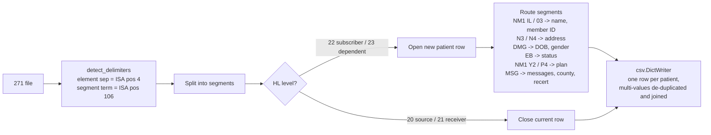

# x12-271-to-csv

[](https://github.com/david-axelrod-tech/x12-271-to-csv/actions/workflows/ci.yml)


[](LICENSE)

Flatten an **ANSI X12 271 Eligibility Response** into a spreadsheet-friendly CSV with
**one row per patient**.

A 271 is what a payer sends back when you ask "is this person covered?" (a 270 request).
Payers return it as a dense hierarchical EDI stream that is hard for billing and intake
staff to read. This script turns a batch 271 into something you can open in Excel, filter,
VLOOKUP against a census, or load into a database.

```text
ISA*00*          *00*          *ZZ*PAYER01 ...~GS*HB*...~ST*271*0001*005010X279A1~
HL*3*2*22*0~NM1*IL*1*DOE*JANE*Q***MI*ZZ12345A~N3*123 MAPLE ST*APT 4~N4*SPRINGDALE*NY*12345~
DMG*D8*19500614*F~EB*1**30**MEDICAID~NM1*Y2*2*HAVENBROOK HEALTH PLAN*****PI*MCO001~
MSG*CNTY CD=35~MSG*RECERT MONTH=0925~ ...
```

becomes

| HL_ID | Member_ID | First_Name | Last_Name | DOB | Gender | City | State | Eligibility_Status | Insurance_Plans | County_Code | Recert_Month |
|---|---|---|---|---|---|---|---|---|---|---|---|
| 3 | ZZ12345A | JANE | DOE | 1950-06-14 | F | SPRINGDALE | NY | MEDICAID | HAVENBROOK HEALTH PLAN | 35 | 0925 |

## Features

- **One row per patient.** Each subscriber (`HL*..*22`) and dependent (`HL*..*23`) loop
  becomes exactly one row, no matter how many `EB`, `MSG`, or plan segments it contains.
- **Delimiter auto-detection.** Element and segment separators are read from the ISA
  header, so files that use `|`, `^`, line feeds, or anything else just work.
- **Multi-valued fields are collapsed, not dropped.** Eligibility statuses, plan names,
  and plan IDs are de-duplicated and joined with `; ` so nothing is lost.
- **Managed-care enrollment captured.** `NM1*Y2` / `NM1*P4` plan names and IDs are
  pulled into their own columns.
- **State Medicaid free-text fields parsed.** NY Medicaid (eMedNY) returns county code
  and recertification month inside `MSG` segments; those are extracted into dedicated
  columns. All raw messages are kept in `All_Messages`.
- **Zero dependencies.** Python 3.9+ standard library only. Drop it on any workstation or
  server.

## Usage

```bash
python x12_271_to_csv.py response.x12                 # writes response.csv next to the input
python x12_271_to_csv.py response.x12 -o eligibility.csv
```

Try it on the included synthetic sample:

```bash
python x12_271_to_csv.py samples/sample_271.x12 -o out.csv
```

Or use it as a library:

```python
from x12_271_to_csv import parse_271

with open("response.x12") as fh:
    patients = parse_271(fh.read())      # list of dicts, one per patient
```

## Output columns

| Column | Source segment | Notes |
|---|---|---|
| `HL_ID` | `HL01` | Hierarchical ID of the patient loop |
| `Member_ID` | `NM1*IL` / `NM1*03`, element 09 | Subscriber or dependent member ID |
| `First_Name`, `Last_Name`, `Middle_Initial` | `NM1*IL` / `NM1*03` | |
| `DOB` | `DMG02` | Reformatted `CCYYMMDD` to `YYYY-MM-DD` |
| `Gender` | `DMG03` | |
| `Street`, `City`, `State`, `Zip` | `N3`, `N4` | Address lines 1 and 2 are joined |
| `Eligibility_Status` | `EB05` | De-duplicated, `; `-joined (e.g. `MEDICAID; QMB`) |
| `Insurance_Plans`, `Insurance_Plan_IDs` | `NM1*Y2`, `NM1*P4` (and other payer entities) | Managed care / other payer enrollment |
| `County_Code` | `MSG` containing `CNTY CD=` | NY Medicaid specific |
| `Recert_Month` | `MSG` containing `RECERT MONTH=` | NY Medicaid specific |
| `All_Messages` | every `MSG01` | Raw payer messages, `; `-joined |

## How it works



### 271 loop coverage (005010X279A1)

| Loop | HL level | Segments read | Goes to |
|---|---|---|---|
| 2000A information source (payer) | 20 | none | closes the open row |
| 2000B information receiver (provider) | 21 | none | closes the open row |
| 2000C subscriber | 22 | `TRN` ignored | opens a row |
| 2100C subscriber name | | `NM1*IL`, `N3`, `N4`, `DMG` | name, member ID, address, DOB, gender |
| 2110C eligibility or benefit | | `EB`, `MSG` | `Eligibility_Status`, `All_Messages`, `County_Code`, `Recert_Month` |
| 2120C benefit related entity | | `NM1*Y2`, `NM1*P4`, other payer codes | `Insurance_Plans`, `Insurance_Plan_IDs` |
| 2000D dependent | 23 | | opens its own row |
| 2100D / 2110D / 2120D dependent detail | | `NM1*03`, `N3`, `N4`, `DMG`, `EB`, `MSG`, plan `NM1` | same columns as the subscriber |

## Background

Built while running eligibility verification for a multi-state home-care provider, where
a nightly batch 270/271 cycle covered tens of thousands of Medicaid members. Intake and
A/R teams needed to see, at a glance, who was active, which managed-care plan they were
enrolled in, and when their recertification was due. This script replaced manual reading
of raw EDI with a CSV that could be joined to the census in minutes.

## Edge cases

| Situation | Behaviour |
|---|---|
| ISA header missing or shorter than 106 characters | Falls back to `*` and `~`; the rest of the file is still parsed. |
| Non-standard separators (`\|`, `^`, line feeds) | Read from the ISA; covered by a unit test. |
| Segment shorter than the element being read | Column is left blank; the parser never raises on a short segment. |
| Several `EB` or plan segments for one patient | De-duplicated in first-seen order and joined with `; `. |
| Dependent (`HL*23`) under a subscriber | Gets its own row, with its own address and plan; nothing bleeds into the subscriber's row. |
| New `HL*20` or `HL*21` mid-file (multi-payer or multi-provider batches) | Current row is closed; the next `HL*22` starts fresh. |
| End of file inside a patient loop | Last row is flushed. |
| Stray non-UTF-8 bytes | Read with `errors="ignore"`; the run does not abort. |
| `DMG02` not 8 digits | Written as received instead of being misformatted. |
| `MSG` text without the NY Medicaid patterns | Still kept verbatim in `All_Messages`. |

## Limitations

- Designed around the 005010X279A1 implementation guide as returned by state Medicaid
  and commercial payers; benefit-level detail (`EB` copay/deductible amounts, `HSD`,
  `III`) is intentionally summarised to a status rather than exploded into columns.
- `County_Code` and `Recert_Month` parsing is specific to NY Medicaid's `MSG` text; other
  payers' messages are still captured verbatim in `All_Messages`.
- One file per run. Wrap it in a loop (or import `parse_271`) for directories.

## Tests

```bash
python -m unittest discover -s tests -v
```

## License

MIT. See [LICENSE](LICENSE).

## Author

David Axelrod. Healthcare revenue-cycle and EDI technology.
[LinkedIn](https://www.linkedin.com/in/david-axelrod-tech/)
